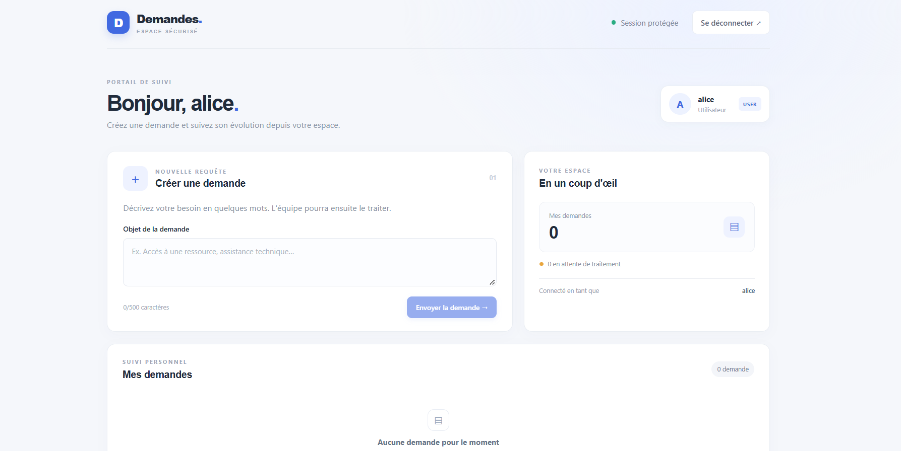
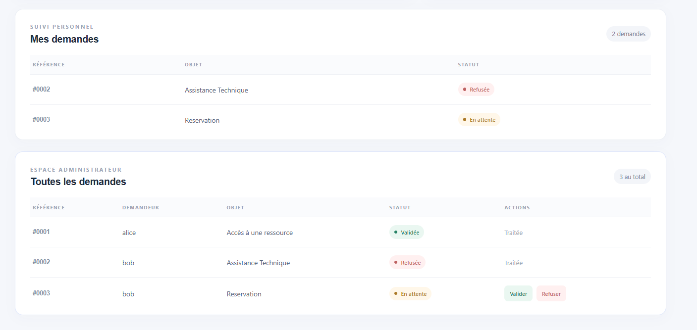

<div align="center">

# Portail de gestion des demandes

Application web de création et de suivi de demandes, avec authentification centralisée et accès contrôlé par rôle.

**React · Spring Boot · Spring Security · Keycloak · OpenID Connect**

</div>

## Présentation

Le portail permet aux utilisateurs de soumettre des demandes et d'en suivre le statut. Les administrateurs disposent d'un espace dédié pour consulter toutes les demandes et les valider ou les refuser.

L'authentification est assurée par Keycloak. Le frontend utilise OpenID Connect avec Authorization Code et PKCE (S256), tandis que l'API Spring Boot valide les jetons JWT et applique les règles d'accès côté serveur.

> **Stockage des demandes :** les données sont conservées en mémoire par l'API et sont perdues lorsque celle-ci redémarre.

## Aperçu

### Espace utilisateur



*Création et suivi des demandes depuis l'espace personnel.*

### Espace administrateur



*Consultation de toutes les demandes et traitement de celles en attente.*

## Fonctionnalités

- Connexion et déconnexion via Keycloak.
- Création et suivi des demandes personnelles.
- Affichage du statut : en attente, validée ou refusée.
- Gestion des demandes par les utilisateurs ayant le rôle `ADMIN`.
- Autorisation vérifiée par l'API, indépendamment de l'affichage du frontend.
- API protégée par des jetons JWT et configuration CORS limitée au frontend local.

## Technologies

| Composant | Technologies |
| --- | --- |
| Frontend | React 19, Vite, `keycloak-js` |
| API | Java 17+, Spring Boot 3.5, Spring Security |
| Authentification | Keycloak, OpenID Connect, OAuth 2.0, PKCE |
| Infrastructure locale | Docker Compose |

## Prérequis

- Docker Desktop avec Docker Compose.
- Java 17 ou supérieur et Maven 3.9+.
- Node.js 20+ et npm.
- Un navigateur web récent.

## Démarrage local

Ouvrez un terminal à la racine du projet, dans le dossier contenant `docker-compose.yml`.

### 1. Démarrer Keycloak

```bash
docker compose up -d
```

Le port hôte **8080** étant susceptible d'être utilisé par un autre service, Keycloak est exposé sur **http://localhost:8082**. Le premier démarrage peut prendre quelques instants. Le realm `enset-realm`, le client `react-client`, les rôles et les comptes de démonstration sont importés depuis `keycloak/realm/enset-realm-realm.json`.

Pour vérifier l'état du conteneur :

```bash
docker compose ps
docker compose logs -f keycloak
```

### 2. Démarrer l'API

Dans un nouveau terminal, depuis la racine du projet :

```bash
cd demandes-api
mvn spring-boot:run
```

L'API est disponible sur **http://localhost:8081**.

### 3. Démarrer le frontend

Dans un autre terminal :

```bash
cd demandes-front
npm install
npm run dev
```

Ouvrez **http://localhost:5173**. Vous serez redirigé vers Keycloak pour vous connecter.

## Comptes de démonstration

| Identifiant | Mot de passe | Rôle |
| --- | --- | --- |
| `alice` | `alice123` | `USER` |
| `bob` | `bob123` | `USER`, `ADMIN` |

Console d'administration Keycloak : **http://localhost:8082/admin**. Les identifiants locaux définis dans `docker-compose.yml` sont `admin` / `admin`.

> Ces comptes et mots de passe sont réservés à l'environnement local de démonstration. Ne les utilisez pas en production.

## API

| Méthode | Route | Accès | Description |
| --- | --- | --- | --- |
| `GET` | `/api/public` | Public | Vérifier l'accès à l'API |
| `GET` | `/api/profil` | `USER`, `ADMIN` | Obtenir le profil connecté |
| `GET` | `/api/demandes` | `USER`, `ADMIN` | Lister ses demandes |
| `POST` | `/api/demandes` | `USER`, `ADMIN` | Créer une demande |
| `GET` | `/api/admin/demandes` | `ADMIN` | Lister toutes les demandes |
| `PATCH` | `/api/admin/demandes/{id}` | `ADMIN` | Définir le statut `VALIDEE` ou `REFUSEE` |

Les demandes créées doivent contenir un objet non vide, limité à 500 caractères côté interface.

## Sécurité et configuration

- Le client Keycloak `react-client` est un client public utilisant Authorization Code avec PKCE S256.
- Les flux implicite et d'accès direct par mot de passe sont désactivés.
- Les rôles `USER` et `ADMIN` sont extraits de `realm_access.roles` du JWT et convertis en autorités Spring.
- L'API valide l'émetteur du JWT configuré dans `demandes-api/src/main/resources/application.properties`.
- CORS autorise uniquement `http://localhost:5173`.
- Les ports locaux sont configurés comme suit : frontend `5173`, API `8081`, Keycloak `8082` (port interne du conteneur `8080`).

## Vérification manuelle

1. Connectez-vous avec `alice`, créez une demande et vérifiez qu'elle apparaît dans son espace sans panneau d'administration.
2. Connectez-vous avec `bob`, vérifiez la liste globale et validez ou refusez une demande.
3. Vérifiez que `GET http://localhost:8081/api/demandes` sans jeton renvoie `401`.
4. Vérifiez que `GET http://localhost:8081/api/admin/demandes` renvoie `403` pour Alice et `200` pour Bob.
5. Vérifiez qu'un jeton invalide est refusé avec `401`.

Ne copiez pas de jeton d'accès dans le README, les captures d'écran ou les commits : un JWT porteur doit rester confidentiel.

## Structure du projet

```text
.
├── docker-compose.yml
├── keycloak/
│   └── realm/
│       └── enset-realm-realm.json
├── demandes-api/       # API REST Spring Boot
├── demandes-front/     # Application React + Vite
└── screens/            # Captures d'écran de démonstration
```

## Réinitialiser Keycloak

Pour arrêter les services sans supprimer les données :

```bash
docker compose down
```

Pour repartir de zéro et supprimer également le volume Keycloak :

```bash
docker compose down -v
```

> **Attention :** `docker compose down -v` efface les données locales de Keycloak.
